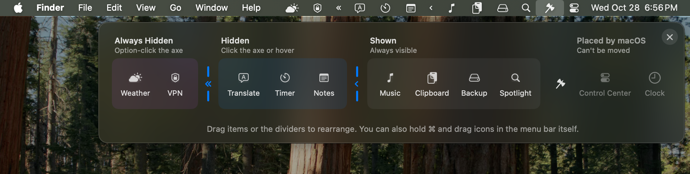
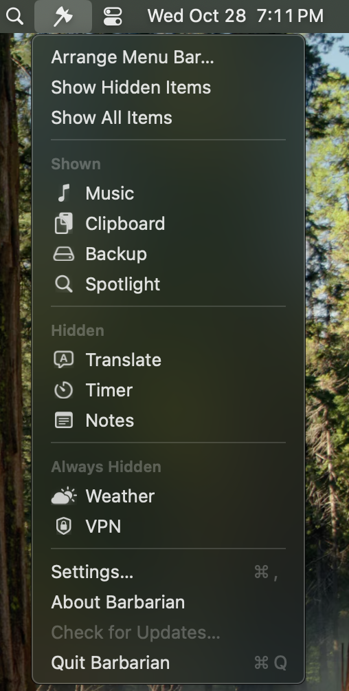

# Barbarian

A free, open-source menu bar manager for macOS 15 and later. It hides the menu bar items you rarely use, keeps every item one click away, and lets you rearrange them by dragging.



## Install

Download the zip from the [latest release](https://github.com/petekp/barbarian/releases/latest), unzip it, and move Barbarian to Applications. Or install it with Homebrew:

```sh
brew install --cask petekp/tap/barbarian
```

Barbarian checks for updates and installs them itself.

Barbarian has been tested on macOS 15. It is built for macOS 26 too, but nobody has tested it there yet. Please [open an issue](https://github.com/petekp/barbarian/issues) if something breaks.

## Permissions

| Permission | What it is for | Without it |
|---|---|---|
| Accessibility | Moving items when you arrange them, and opening items that do not fit in the menu bar | Hiding and showing items still work |
| Screen Recording, optional | Showing each item's own icon in Barbarian's menu, when "Show items' own icons" is on in Settings | Items show their app's icon |

## Use


Barbarian adds an icon and two dividers to the menu bar. Items right of the ‹ divider are shown. Items between the « and ‹ dividers are hidden. Items left of « stay hidden until you ask for all of them.

| To | Do |
|---|---|
| Show hidden items | Click Barbarian's icon, press Control-Option-Command-B, or rest the pointer on the empty part of the menu bar |
| Show every item | Option-click Barbarian's icon |
| Open any item, even one that does not fit | Right-click Barbarian's icon or press Control-Option-Command-M, then pick the item or type its name |
| Rearrange | Choose Arrange Menu Bar… from that menu and drag items or dividers. Or show every item, so both dividers are visible, and hold Command while dragging icons in the menu bar |

Hidden items hide again a few seconds after the pointer leaves the menu bar.



## Privacy

Barbarian collects nothing. Its only network request is the update check, which downloads the list of releases from GitHub.

## Build from source

Barbarian needs Swift 6.2, which comes with Xcode 26.

```sh
scripts/build-app.sh
open ~/Applications/Barbarian.app
```

macOS ties the Accessibility grant to the app's signature. Set `BARBARIAN_SIGNING_IDENTITY` to your code signing certificate's hash, from `security find-identity -v -p codesigning`, so a rebuild keeps the grant. Run the tests with `swift test`. `docs/architecture.md` explains how Barbarian works.

## License

MIT. See `LICENSE`.
